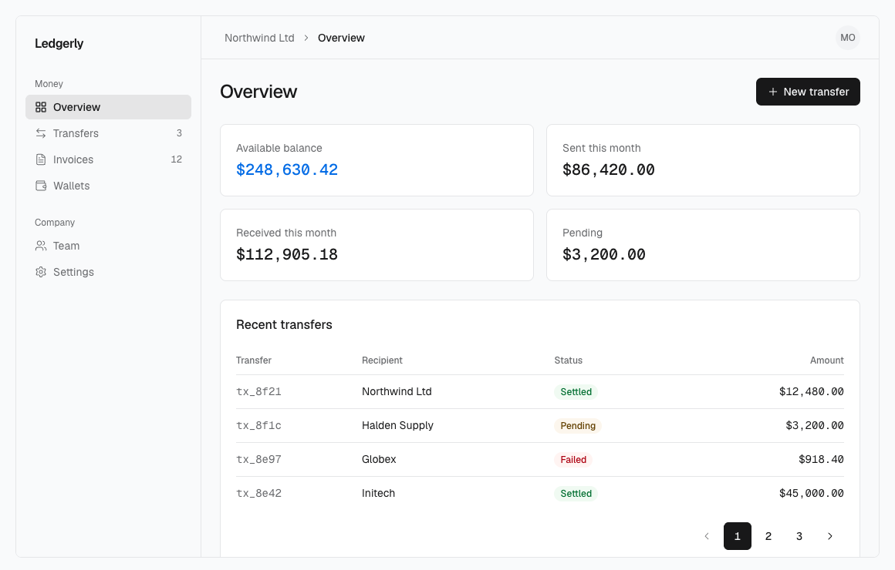
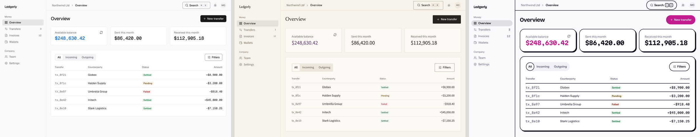

```
  ███████╗██╗███╗   ██╗███████╗
  ██╔════╝██║████╗  ██║██╔════╝
  █████╗  ██║██╔██╗ ██║█████╗
  ██╔══╝  ██║██║╚██╗██║██╔══╝
  ██║     ██║██║ ╚████║███████╗
  ╚═╝     ╚═╝╚═╝  ╚═══╝╚══════╝
```


React design system: Base UI primitives, Tailwind CSS v4 tokens, Motion springs, distributed as a shadcn registry.

Live site: https://fine-design.qeqx.chatgpt.site



```
┌─ status ──────────────────────────────────────────────────────────────┐
│  built     3 presets · 52 components · 7 blocks · docs site · tests   │
│  live      shadcn registry · llms.txt · agent plugin                  │
└───────────────────────────────────────────────────────────────────────┘
```

## How it fits together

```
 scripts/presets/*.mjs ──▶ scripts/tokens.mjs ──▶ styles/fine.css (Ledger) ─┐
  appearance: one file      OKLCH math, contrast    styles/presets/<n>.css   ├─▶ components/ui/*.tsx ──▶ registry.json ──▶ public/r/*.json
  per preset (values        gate per preset,        styles/presets.css       │    Base UI + cva + Motion    shadcn build       npx shadcn add
  only)                     fails on any AA miss    styles/tokens.json       │    tiers; tokens only                           <site>/r/<name>.json
                                                    lib/motion.ts ───────────┘
```

Behavior (Base UI roles, keyboard, focus, validation, motion tiers, reduced motion) lives in the components and is the same in every preset. Appearance (colors, fonts, weights, radii, type scale, control sizes, padding, border width, shadows) lives in presets.

Agents: read [AGENTS.md](AGENTS.md) (using and changing the system) and `/llms.txt` on the docs site (per-item index), or install the plugin below.

## Use with agents

- Claude Code: `/plugin marketplace add anon5376/fine-design`, then `/plugin install fine-design@fine-design`. Adds the `fine-design` skill and the shadcn MCP server (search, view, add).
- Codex and other agents: copy `plugin/skills/fine-design` into the agent's skills directory (Codex: `~/.codex/skills/fine-design/`).
- Any project: add the namespace to `components.json`, then `npx shadcn@latest add @fine/button`. For agent tools, run `npx shadcn@latest mcp`.

```json
"registries": { "@fine": "https://fine-design.qeqx.chatgpt.site/r/{name}.json" }
```

`https://fine-design.qeqx.chatgpt.site/llms.txt` is the per-item index for agents.

## Install from the registry

Install a theme once, then components. Components never re-skin a project.

```bash
npx shadcn@latest add https://fine-design.qeqx.chatgpt.site/r/theme-ledger.json   # or theme-folio, theme-poster
npx shadcn@latest add https://fine-design.qeqx.chatgpt.site/r/button.json
```

- Every component depends on `fine-base`: the Tailwind mappings, the `figures`, `figure-fit`, `focus-ring` and `border-line` utilities, keyframes, and Ledger defaults in a cascade layer. Your `:root` and any installed theme win over those defaults, so a component added later does not change your look. A component installed without a theme renders in Ledger.
- A theme writes values only (colors, fonts, weights, radii, type scale, control sizes, padding, border width, shadows) to `:root`, `.light`, `.dark` and the OS dark query. A second theme replaces the first. `fine-theme` is an alias of `theme-ledger`. It keeps Tailwind's own palette.
- Load the fonts listed in the theme item's `meta.fonts` with next/font, passing an entry's `axes` or `weights` (as `axes` and `weight`) when it lists them: Folio's Newsreader and Poster's Bricolage Grotesque list `opsz`. Ledger needs Geist as `--font-geist-sans` and `--font-geist-mono`.
- Project needs React 19, Tailwind v4 and the default `components.json` aliases. After `shadcn init`, add `--overwrite` so Fine's `button` and `utils` replace init's.
- Items reference each other by absolute URL, taken from `REGISTRY_URL` at build time (default `http://localhost:4319`). For a deploy: `REGISTRY_URL=https://<host> npm run build`.
- Every docs page shows its install line. `/r/registry.json` indexes all 68 items: 52 ui, 7 blocks, 4 lib, `fine-base`, and 4 theme items (`theme-ledger`, `theme-folio`, `theme-poster`, `fine-theme`).

## Develop

```bash
npm install
npm run dev              # docs on port 4318
npm run tokens           # regenerate CSS, JSON, motion for every preset; exits 1 on a contrast, accent/danger hue or gamut failure
npm run registry:build   # registry.json + public/llms.txt, then shadcn build → public/r/*.json (68 items)
npm run build            # tokens → registry:build → static site in out/
npm run serve            # serve out/ on PORT (default 4319)
npm run typecheck
npm run check:snippets   # typecheck every copyable docs snippet
npm test                 # Playwright: keyboard, motion, axe; needs a build, uses installed Chrome
npm run verify           # build → typecheck → snippets → Playwright
npm run verify:install   # install theme-folio, select and dialog into a fresh Next app, then fine-base alone, and check both; needs network and a prior build
node scripts/screenshots.mts [states]   # every page at 375/1440, light/dark → screenshots/
node scripts/motion-tour.mts            # motion video tour → screenshots/motion/ (needs ffmpeg)
node scripts/showcase-video.mts        # 1080p60 promo reel of /showcase → screenshots/x/ (needs ffmpeg)
node scripts/render-film.mts           # deterministic launch film of /film (virtual clock, 1080p60) → screenshots/x/fine-film.mp4; --path /film/v03/ renders the 0.3 film → fine-0.3.mp4; --from/--to/--stills for partials (build first; needs ffmpeg)
node scripts/launch-assets.mts all     # README and listing assets: docs/demo.gif, themes.png, social-preview.png, plugin icon; or gif|themes|preview|icon, --out <dir> (build first; needs ffmpeg and the film for the gif)
```

## Presets

```
 ┌─ behavior (same everywhere) ───────────┐      ┌─ appearance (a preset) ─────────────────────────────────┐
 │ Base UI roles · keyboard · focus       │      │ colors  fonts  weights  radii  type scale               │
 │ validation · motion tiers · reduced    │      │ control sizes  padding  border width  shadows           │
 │ motion · contrast gate · token-only    │      │ ledger · folio · poster   (scripts/presets/<name>.mjs)  │
 │ styling                                │      │                                                         │
 └────────────────────────────────────────┘      └─────────────────────────────────────────────────────────┘
```



Ledger, Folio and Poster, left to right: the same components on the same page, only the preset differs.

| Preset | Direction | Take it for |
|---|---|---|
| Ledger | Achromatic, dense, flat at rest, ink chrome with one cobalt accent | Dashboards, admin and finance tools |
| Folio | Editorial, set for reading: warm paper, serif titles, one quiet aubergine accent | Docs, publications, content-led pages |
| Poster | Loud, large type, strong contrast: a flat hot magenta for the main action and the accent, hard shadows | Launches, campaigns, marketing pages |

The table states each preset's intent. Exact values are in `scripts/presets/<name>.mjs` and `styles/tokens.json`.

- Components use semantic and preset utilities only: `bg-primary`, `text-muted-foreground`, `border-line`, `rounded-control`, `h-control-md`, `px-pad-field-md`, `font-label`. The token contract table is in [AGENTS.md](AGENTS.md#tokens). The docs site removes Tailwind's default palette, so `bg-blue-500` does not exist there (an installed project keeps its palette).
- Switching: in a project, install the other theme. In the docs, the Preset select in the sidebar sets `data-preset` on `<html>`; no attribute means Ledger.
- Dark mode: `.dark` or `.light` on `<html>` (or any subtree). Without either class, the OS setting decides.
- Making a preset: copy `scripts/presets/ledger.mjs` to `scripts/presets/<name>.mjs`, add its font loaders to `site/presets.ts`, run `npm run tokens`. Every text/background pair must pass WCAG AA (4.5:1 text, 3:1 UI), every color must fit in sRGB, and the accent (and a chromatic primary) must sit 40 degrees or more from danger in hue so it never reads as an error, or the script fails. `npm run build` then produces `theme-<name>`.
- Before building a new site or screen, settle the direction (audience, content, typography, palette, composition, imagery, interaction character), pick the closest preset or derive one, then build with Fine components. A small edit inside an existing screen follows that screen.
- Ledger's rules: ink chrome, `accent` (cobalt) on the main data element only, `figures` (Geist Mono, tabular digits) on money, counts, IDs and addresses, no shadows on things at rest, no taglines or secondary labels.
- Forms show a hint under any input with a rule or a format: `FieldDescription` inside `Field`, linked to the input through `aria-describedby`.

## Motion

```
 tier         enter spring                   exit tween   moves
 ──────────   ────────────────────────────   ──────────   ─────────────────────────────
 fast         80ms  · bounce 0               60ms         hover, focus, highlights, tooltips
 moderate     160ms · bounce 0               120ms        popup enters (select, combobox, menu, popover), drawers, indicators
 slow         240ms · bounce 0.12            160ms        dialogs, command palette
 expressive   420ms · bounce 0.28 (≈810ms)   160ms        toasts: feedback arriving, the one visible overshoot
```

Enter on `spring.<tier>`, exit on `spring.<tier>.exit` (`lib/motion.ts`); expressive is RareUI's visual duration (the CSS curve runs the full ≈810ms settle) and exits on slow's tween, and popups leave on fast's exit. CSS uses `duration-(--duration-<tier>)` with `ease-spring-<tier>` to enter and `duration-<tier>-exit` with `ease-exit` to leave. Every other transition defaults to `--ease-enter`, and Motion tweens take `easing.enter` and `easing.exit`. Lists, menus and nav share one hover highlight that glides between items (`useFluidHover` + `<FluidHighlight>` in `lib/fluid-hover.tsx`). Prefer transform and opacity; width is animated only where the size is the information (progress fill, switch thumb, highlight, a figure gaining a digit, slider position). Wrap apps in `<MotionConfig reducedMotion="user">`; with reduced motion on, movement is dropped and fades remain.

Fine's own animations (original, not borrowed) animate only a change the user needs to notice, on the same tiers, with no loops and no entrance on page load. Reduced motion keeps at most a fade, and the final value or name is in the accessibility tree on the click.

```
 animation            where                     tier                           reduced motion
 ──────────────────   ───────────────────────   ────────────────────────────   ───────────────────
 digit roll           AnimatedNumber, pricing   moderate (exit 120ms tween)    fade only
 tag removal          TagList + Tag             fast exit; siblings moderate   fade, siblings jump
 slider track press   Slider                    moderate (CSS)                 jump
 avatar image fade    Avatar                    fast                           fade kept
 theme crossfade      docs ThemeToggle          moderate (view transition)     instant
```

Still static: Alert, Badge, the Navbar wordmark, a Tag outside a `TagList`, and slider drag and keyboard steps (a drag must track the pointer exactly).

## Layout

```
 fine-design/
 ├─ components/
 │  ├─ ui/            one file per component (installed to the same path)
 │  └─ blocks/        compositions of components/ui only: auth-form · hero ·
 │                     feature-grid · pricing · faq · footer · dashboard-shell
 ├─ lib/              utils (cn) · popup · fluid-hover · motion (generated)
 ├─ styles/           fine.css · presets/<name>.css · presets.css · tokens.json (generated)
 ├─ scripts/          tokens · presets/<name>.mjs · registry · verify-install · check-snippets · serve · screenshots · motion-tour · launch-assets
 ├─ site/             docs-only code: nav, examples/<slug>.tsx, presets.ts, preset-switch, chrome
 ├─ app/              docs routes: /tokens · /components/[slug] · /blocks/[slug]
 ├─ tests/            keyboard · motion · a11y · layout · anim-* (373 Playwright tests, against out/)
 ├─ plugin/           Claude Code plugin: skills/fine-design (also usable in Codex) + .mcp.json
 ├─ .claude-plugin/   marketplace.json for `/plugin marketplace add`
 └─ registry.json · public/r/ · public/llms.txt   generated by registry:build
```

## Adding a component

1. Write `components/ui/<name>.tsx`: Base UI primitive underneath, `cva` for `variant`/`size`, semantic and preset utilities only, `focus-visible:focus-ring`.
2. Motion, if any, comes from a source animation mapped onto `spring.<tier>`, or is the one change the user needs to notice. Static is fine.
3. Add `site/examples/<name>.tsx`. Each exported function is one live example, and its source is the copyable code.
4. Add the entry to `site/nav.ts`, and its category and one-line description to `UI` in `scripts/registry.mjs` (the build fails if either is missing).
5. Run `npm run typecheck && npm run check:snippets && npm run build && npm test`.

## Credits

Full notices and licenses: [THIRD-PARTY-NOTICES.md](THIRD-PARTY-NOTICES.md). Fine itself is [MIT](LICENSE).

| From | License | Used for |
|---|---|---|
| [Fluid Functionalism](https://github.com/mickadesign/fluid-functionalism) | MIT | motion tiers, hover highlight, button press geometry, spinner, icon stroke hover |
| [Rare UI](https://rareui.com) | MIT + Commons Clause + Attribution | expressive tier: the FAQ reply bubble's SEND spring (visualDuration 0.42, bounce 0.28); the hero's falling-slips moment takes its idea from Gravity Letters (idea only, no code); the ten 0.4 animations (`CopyButton`, `AsyncStatus`, `AutoHeight`, `ConfirmButton`, `ReactionButton`, `NotificationBell`, `PasswordInput`, `OtpInput`, `Checklist`, `Stepper`) take their ideas from Rare UI's matching components (ideas only, code written from scratch) |
| [easyui](https://easyui.site) | MIT | Pagination active-page slide: SlidePagination's shared-layoutId technique, rewritten onto our tokens |
| [taste-skill](https://github.com/Leonxlnx/taste-skill) | MIT | art direction: the Ledger preset's "achromatic ledger" style (ink chrome, mono figures, 6/8 radius) |
| [Base UI](https://github.com/mui/base-ui) | MIT | primitives |

The digit roll, tag removal, slider glide, avatar fade and theme crossfade are Fine's own and have no source to credit.
